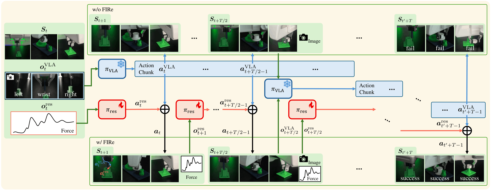

# FIRe — Force-Informed Residual Policy

FIRe improves a **Vision-Language-Action (VLA)** model at **contact-rich robotic assembly**
(peg insertion, gear meshing, nut threading) by adding a **force-aware residual RL policy** on top of
it. The VLA plans long-horizon action chunks from vision and language. The residual policy observes
contact force at every control step and adds a bounded correction to each action. It is trained in
simulation and runs zero-shot on a real Franka FR3.

**Project page:** https://anonymous.4open.science/w/FIRe-3E69/



*Without FIRe (top), the frozen VLA executes its action chunks open-loop and the insertion fails.
With FIRe (bottom), the force-aware residual policy corrects every action of the chunk at the control
rate, and the same task succeeds.*

## Paper

### Method

- **Base policy.** A VLA whose action head is fine-tuned on demonstrations and then frozen. GR00T N1.5
  is the primary backbone. It receives two external camera images, one wrist camera image, the
  end-effector pose and a language instruction, and outputs an action chunk.
- **Residual policy.** Observes the end-effector pose relative to the fixed part, the end-effector
  velocity, the contact force from a wrist force sensor, the reference contact force F_ref and the
  previous command. Both policies act in the same relative-pose space, so the final command is the sum
  `a_t = a_t^VLA + a_t^res`, executed by a task-space impedance controller at 1 kHz while the policies
  run at 15 Hz.
- **Slow-fast loop.** The next VLA chunk is prefetched at the midpoint of the current one, so the
  control loop never waits for VLA inference and the residual corrects every step.
- **Reward.** A sparse success indicator `r_s` plus a force-aware term `r_f` that is nonzero only when
  the contact force exceeds F_ref. The same reward, with the same hyperparameters, is used on every
  task, so no task-specific dense reward is engineered.
- **Training.** PPO with an asymmetric actor-critic in Isaac Lab. The actor sees only what is available
  on the robot, and the critic also receives privileged simulator state. The trained policy is deployed
  on the real robot without fine-tuning.

### Results

Real-robot success over 30 trials per method:

| Method | Peg Insert | Gear Mesh | Nut Thread |
|---|---|---|---|
| VLA (GR00T) | 23.3% | 10.0% | 3.3% |
| RL dense (task-specific dense reward) | 86.7% | 100.0% | 33.3% |
| **FIRe** | **96.7%** | **100.0%** | **33.3%** |

- FIRe improves over the VLA-based policy by 64.5 percentage points on average and by up to 90.0, and
  its success rates do not differ significantly from those of RL dense.
- On Peg Insert, removing either the force observation or the force-aware reward from the residual
  policy lowers success significantly.
- The residual trained with GR00T for each task is applied to π0.5 and OpenVLA without retraining,
  and success rises for every backbone on every task.

The project page has the full tables, the failure analysis, the implementation settings and videos of
the real-robot trials.

## Code

### Repository layout

- **`firelab/`** — Isaac Lab tasks for FIRe.
  - `firelab/tasks/fire/` — the FIRe environments (`fire_env.py`), their configurations
    (`fire_env_cfg.py`, `tasks_cfg.py`, `vla_env_cfg.py`), the end-effector frame conversions and
    action units (`eef_frame_utils.py`) and the PPO configurations (`agents/`).
  - `firelab/tasks/factory/` — the Factory assembly tasks (Peg Insert, Gear Mesh, Nut Thread) that the
    FIRe tasks build on.
  - `firelab/envs/` — the base environment that queries the VLA during simulation, the clients for
    the VLA policy servers (GR00T, π0.5, OpenVLA) and the action-chunk handling.
- **`scripts/`** — training, evaluation, the VLA server launcher and the success-rate statistics.
- **`docs/`** — the project page.

### Registered tasks

| Task ID | Policy |
|---|---|
| `FIRe-PegInsert-v0`, `FIRe-GearMesh-v0`, `FIRe-NutThread-v0` | VLA + force-aware residual (FIRe) |
| `FIRe-PegInsert-VLAOnly-v0`, `FIRe-GearMesh-VLAOnly-v0`, `FIRe-NutThread-VLAOnly-v0` | VLA alone, with the residual fixed to zero |

### Requirements

- **Isaac Lab** in a conda environment (default name `isaaclab`, set `ISAACLAB_ENV` to change it).
  Set `CONDA_SH` if `conda.sh` is not at `~/miniconda3/etc/profile.d/conda.sh`.
- **A VLA policy server** for the backbone you use, with an action-head fine-tuned checkpoint.
  `scripts/vla_server.sh` starts it for you:
  - `VLA=gr00t` — [Isaac-GR00T](https://github.com/NVIDIA/Isaac-GR00T) in a conda env named `gr00t`
    (`GR00T_DIR`, default `~/Isaac-GR00T`)
  - `VLA=pi05` — [openpi](https://github.com/Physical-Intelligence/openpi) (`OPENPI_DIR`, default
    `~/openpi`)
  - `VLA=openvla` — [OpenVLA-OFT](https://github.com/moojink/openvla-oft) (`OPENVLA_DIR`, default
    `~/openvla-oft`, conda env `OPENVLA_ENV`)

### Training

```bash
# scripts/train.sh <gpu> <vla_port> <task> <vla_checkpoint> <run_name> [resume_checkpoint]
VLA=gr00t bash scripts/train.sh 0 8888 PegInsert /path/to/gr00t_checkpoint peg_insert
```

`<task>` is `PegInsert`, `GearMesh` or `NutThread`. The script starts the VLA server, trains
`FIRe-<task>-v0` headless and writes the log to `logs/train/`. Checkpoints go to
`logs/rl_games/FIRe/{peg_insert,gear_mesh,nut_thread}/nn/`, and `FIRe.pth` there is the checkpoint
with the highest training success rate
(set `SAVE_BEST=reward` to choose by reward instead). Pass Hydra overrides through `ENV_ARGS`.
Use `<vla_checkpoint>=external` to connect to a VLA server that is already running.

### Evaluation

```bash
# scripts/eval.sh <gpu> <vla_port> <run_name> <vla_checkpoint> <task_id> <residual_checkpoint>
VLA=gr00t bash scripts/eval.sh 0 8888 peg_fire /path/to/gr00t_checkpoint FIRe-PegInsert-v0 \
    logs/rl_games/FIRe/peg_insert/nn/FIRe.pth

# success rate, 95% Wilson interval and Fisher exact test against the first file
python scripts/tools/episode_success.py eval/peg_vla.csv eval/peg_fire.csv
```

`eval.sh` runs `scripts/play.py` on 50 parallel environments and saves the per-step actions and
episode outcomes to `eval/<run_name>.csv`. `SEED` and `MAX_STEPS` change the seed (default 42) and
the number of environment steps (default 1200).

### Configuration

- `firelab/tasks/fire/tasks_cfg.py` — the force-aware reward: `contact_penalty_scale` (α = 2.5e-3),
  `force_shaping_lambda` (λ_f = 0.01), `force_potential_c` (c_f = 1.0) and
  `contact_penalty_threshold_range`, the range from which F_ref is sampled per episode (5–10 N).
- `firelab/tasks/fire/fire_env_cfg.py` — the residual action bound (`RESIDUAL_ACTION_SCALE`), the VLA
  action bound (`vla_clip_m`), the VLA prompt and backbone (`vla_model`, set from the command line as
  `env.vla_model`).
- `firelab/tasks/fire/agents/` — the PPO hyperparameters, including a rollout horizon of 128 for
  Peg Insert and Gear Mesh and 256 for Nut Thread.

---

Based on the paper *"FIRe: Force-Informed Residual Policy for Contact-Rich Manipulation with
Vision-Language-Action Models"* (submitted to IEEE RA-L, 2026).
